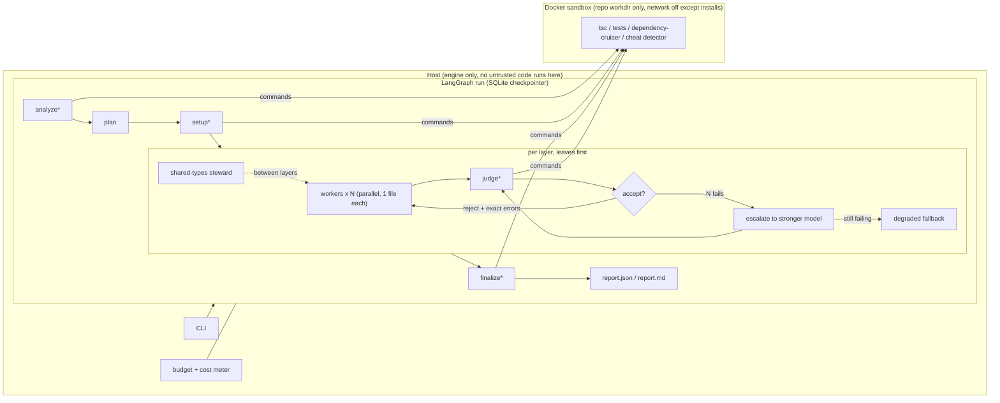

# migration-swarm: architecture (Phase 0 proposal)

Status: proposal for review. Nothing here is built yet except the Docker sandbox runner
(`migration_swarm/core/sandbox.py`) and the benchmark verifier (`scripts/verify_benchmark.py`).

## 1. Shape



`*` = pack-provided (`migration_swarm/migrations/js_to_ts/`). Everything else lives in
`migration_swarm/core/` and makes no TypeScript assumptions.

Layout:

```
migration_swarm/
  core/        sandbox, planner (toposort + SCC), graph wiring, retry/escalation, budget,
               cost meter, checkpointing, report, eval harness, CLI
  migrations/
    js_to_ts/  analyzer (dependency-cruiser), setup, prompts, judge checks,
               cheat detector (TS compiler API, runs in Docker), finalize, ts-migrate baseline
benchmarks/js_to_ts/manifest.yaml (+ verification.json)
```

The core talks to the pack through plain functions. No registry, base classes or plugin loader
until Phase 5 shows what two packs share. `--migration js-to-ts` is a lookup in a dict with one entry.

## 2. Your design, kept as-is

Analyze, plan, setup, per-layer parallel workers with file ownership, a single steward,
a deterministic judge, retry with exact errors, escalation, degraded fallback, finalize,
hard USD budget, SQLite checkpointing, LangSmith tagging, and a generic `escapes: dict[str, int]`
that the core never interprets beyond "sum, compare to budget, report per kLOC".

## 3. What I'd change or pin down, and why

### 3.1 Tests run against a "shadow build", not against `.ts` through a loader (biggest change)

Problem: test files are read-only, and they import source by path (`marked`'s specs do
`import '../../src/marked.js'`; hexo's tests `require('../../lib/hexo')`). To run them against
`.ts` sources you'd need a runtime TS loader (tsx, ts-node, ts-jest) wired into each runner's
config, and those loaders all have gaps: esbuild/tsx and Node's type stripping don't support
`export =` / `import x = require()`, ts-node's ESM loader is unreliable on new Node, and wiring
a jest transform means editing test config.

Proposal: after each layer the judge runs `tsc` (with `allowJs`) to emit JS into a **shadow tree**,
a copy of the repo where every source file (migrated `.ts` or still-`.js`) is replaced by
tsc's emitted `.js` at the **same path**. Tests, fixtures and configs are copied in byte for byte
and run there with the repo's own, unchanged test command.

- No test config edits, no loader, every TS syntax works, and the tests exercise exactly what
  tsc emits (what will ship).
- **Setup gate (deterministic):** before any LLM call, emit the *untouched* JS through tsc into the
  shadow tree and run the suite. It must match the baseline pass count. If it doesn't, setup
  adjusts `target` / `module` / `useDefineForClassFields` and the like, and if it still can't
  match, the repo is reported as "setup failed" without spending anything.
- Module shape is preserved: CJS repos stay CommonJS (`module: commonjs`, and exports keep
  their runtime shape, e.g. `module.exports = fn` becomes `export = fn`, not `export default`);
  ESM repos use `module: nodenext`. Import specifiers keep their spelling (`./foo.js` resolves
  to `foo.ts`). File paths never change except the extension.

### 3.2 Test-failure attribution by bisection

tsc errors carry a file name. Leaves-first ordering means the dependencies of a layer-k file are
already-accepted TS, so new errors in a layer are attributable to that layer's own files.
Test failures carry no file name, so when the suite regresses after a layer the judge
**bisects**: it swaps halves of the layer back to their original emitted JS until it isolates
the culprit files (about k·log2(n) suite runs for k culprits). On jest repos it first narrows the
candidates with `--findRelatedTests`. The bisection cap is configurable; if it's hit, the whole
layer is rejected with the failing test names.

### 3.3 Emitted-JS drift as a cheat signal (addition)

Type annotations erase. So for each migrated file the judge compares tsc's emitted JS against the
emit of the original JS (both normalized through the TS printer with comments stripped). Any
difference is a runtime change. It's reported as an escape count (`runtime_changed_statements`)
with a default budget of 0 and a per-file allowance for narrowing guards. This catches the
"delete the code the compiler complains about" cheat even when tests are weak.

### 3.4 Steward contract

- The steward owns one new file per repo (e.g. `src/__shared_types__.ts`). It must be
  **type-only**: the judge checks that its emit is empty, so it can't change runtime.
- Workers reply with the file plus an optional list of `shared_type_requests`
  `{name, definition, used_by, reason}`. They may use a local placeholder in the meantime.
  Between layers the steward merges or dedupes the requests, then the next layer's workers
  receive the shared file and import it with `import type`.
- If a steward change breaks already-accepted files (whole-project tsc), the steward retries.
  Accepted files are never re-opened silently.

### 3.5 Degraded fallback, defined precisely

1. Haiku worker: up to N retries (default 2) with the exact tsc errors, failing test names and
   escape-budget violations.
2. Sonnet escalation: same contract, one more attempt.
3. Degraded: Sonnet again, with the escape budget for explicit `any` lifted (still no
   `@ts-ignore` / `@ts-nocheck`). The file is accepted as **degraded** and its escapes are counted.
4. If that still fails tsc or tests, the file stays `.js`, `allowJs` stays on at finalize, and the
   report says exactly which files and why. Never silent.

### 3.6 Model calls

- Workers return the file in a fenced ```ts block plus a fenced ```json block for steward
  requests. That's plain text, with no tool calling and no structured-output dependency. (On
  Sonnet 5.5 a forced `tool_choice` returns a 400, so plain text also avoids the most common
  LangChain structured-output path breaking.)
- Prompt caching: the system prompt and the dependency type context go first and get cached,
  and the file under migration goes last.
- **Cost = API-reported usage (input, output, cache read/write tokens) × the price table in
  `config.yaml`.** The API returns tokens, not dollars, so that's the "real" number. Prices:
  Haiku 5.5 $0.10/$0.50 per MTok (≤100K-token prompts, $0.50/$2.50 above that); Sonnet 5.5
  $2/$10. The meter checks the budget **before** each call against a worst-case estimate for
  that call, so a run can't overshoot the hard cap by more than one call's worst case.

### 3.7 Pinned toolchain (one Docker "tools" image per pack)

- TypeScript **6.0.3** for tsc, the cheat detector and the ground-truth comparison. TS 7.0.2 is
  now npm `latest`, but its JS compiler API exists only under `typescript/unstable/*`. 6.0.3 is
  the last release with the stable API. Using one version for every system keeps the
  comparison fair. TS 7's `tsc` could later be a faster judge behind a parity check.
- dependency-cruiser **18.9.0** for analyze. I prefer it over madge (8.0.0, last release
  2024-08): it's maintained, handles mixed CJS/ESM, has JSON output and reports cycles.
- ts-migrate **0.1.35** for the codemod baseline. Its last release was 2022-11, so expect it to
  pin an old TS internally. It's run as-is and judged by our TS 6.0.3, and the report notes that.

### 3.8 Safety: the Claude Code baselines need a sandbox too (decision for you)

The swarm's LLM workers never execute anything. All execution goes through the Docker judge.
The two Claude Code baselines (`claude -p`, and subagents in worktrees) are different: to be
competent they **run tsc and the tests themselves**. Running them on the host would execute
untrusted repo code next to your home dir. Proposal: run Claude Code **inside a container**
whose only egress is an allowlist proxy (api.anthropic.com, plus the npm registry during the
install phase), using a **separate API key with a low workspace spend limit**, because
untrusted test code in that container could read the key. Section 6 asks you about this.

### 3.9 Benchmark hygiene

- Installs run with network into a writable mount. Tests always run with `--network none`, with the
  workdir mounted **read-only**, on a throwaway copy inside the container. Nothing a test suite
  writes reaches the host. This also fixed a real race: hexo has an un-awaited `unlink` that
  fails on Docker Desktop's slow bind mounts and passes on the container filesystem. Each baseline
  suite runs 3 times and must give identical counts to count as stable.
- Tests that need the network or are flaky are excluded **by command-line filter, never by
  editing files**, and listed under `excluded_tests` in the manifest. There are currently 2,
  both in stylelint.
- hexo has no lockfile upstream, so it installs with `npm install --before=<commit date>`, which
  makes resolution reproducible.
- Ground truth is used **only for type-signature comparison**. Some human migrations also
  refactored code or changed tests in the same commit, so their tests aren't reused.
- Ground-truth comparison (defined fully in Phase 2): emit `.d.ts` for both versions and, per
  exported symbol present in both, check *identical* (the `Equals<X, Y>` conditional-type trick)
  and *mutually assignable*, within one TS program. `any`-typed symbols on our side count as
  non-matches. Coverage (the share of GT symbols that exist on our side) is reported separately.

### 3.10 Smaller things

- Per-layer cost: hexo has deep chains of small files, so each layer runs tsc (incremental, cheap)
  plus a test run. If test time dominates, consecutive *small* layers are batched into one judged
  wave, which stays leaves-first and is still bisectable. I'll measure this before tuning it.
- The judge runs in one long-lived container per run (`docker exec`) rather than one container
  per command, so tsc's incremental state stays warm. The container is still network-off.
- The package download cache is a Docker volume (`msw-pkg-cache`) shared between repos and never
  mounted on the host. npm and yarn verify lockfile integrity hashes, so poisoning risk is low.
  It can be split per repo if you'd rather.

## 4. What stays pack-specific (JS->TS)

Analyzer (dependency-cruiser invocation and JSON-to-graph), tsconfig/setup rules, the shadow-build
judge, the cheat detector and its escape keys (`explicit_any`, `implicit_any`, `ts_ignore`,
`ts_expect_error`, `ts_nocheck`, `as_unknown_as`, `non_null_assertion`, `as_cast`,
`runtime_changed_statements`), the test-file hashing rules (`.ts` renames may only add types),
prompts, finalize, ts-migrate baseline, ground-truth type comparison.

## 5. Benchmark (verified)

`benchmarks/js_to_ts/manifest.yaml`, verified by `scripts/verify_benchmark.py` into
`benchmarks/js_to_ts/verification.json` (2026-11-27). Source LOC are cloc JavaScript code lines
in the source dirs, excluding tests.

| repo | source LOC | files | module | runner | ground truth | tests passing (skipped) | stable runs |
|---|---:|---:|---|---|---|---:|---|
| cheerio | 1,539 | 13 | CJS | jest | `726f94a` (moved lib/ to src/) | 693 (0) | 3/3 |
| yup | 1,895 | 26 | ESM (babel) | jest | `b97c39d` (24/26 files) | 572 (2) | 3/3 |
| marked | 2,349 | 12 | ESM (native) | jasmine | `cb54906` | 1,629 (0) | 3/3 |
| hexo | 6,312 | 144 | CJS | mocha | `148ed7c` | 1,147 (5) | 3/3 |
| knex | 18,493 | 146 | CJS | mocha (unit) | none | 1,849 (50) | 3/3 |
| stylelint | 25,297 | 393 | CJS | jest | none | 14,187 (13) | 3/3 (+5/5 earlier) |
| mathjs | 37,607 | 676 | ESM (native) | mocha | none | 6,717 (21) | 3/3 |

Considered and not used: socket.io (992 LOC), uuid (734), cron (754) and htmlparser2 (1,428),
which were too small to exercise a swarm; express-validator, whose "migration" was a rewrite; and
redux and helmet, where no clean JS-to-TS commit was found in history.

## 6. Decisions (approved 2026-11-27)

1. Shadow-build judging (3.1): **yes**, tests run against tsc's emitted JS at the original paths.
2. Claude Code baselines (3.8): **locked-down container**, egress limited to the Anthropic API,
   with a separate spend-limited key.
3. Emitted-JS drift (3.3): **rejecting** escape type, default budget 0.

## 6. Running on a Claude plan instead of a billed key (`--backend plan`)

Added 2026-11-27 so the benchmark can run on a Pro plan.
Per https://support.claude.com/en/articles/15036540, `claude -p` and the Claude Agent SDK draw
from plan limits when signed in with a plan. Direct Messages API calls are not covered.

- **Swarm:** each model call becomes one Claude Agent SDK turn (`core/plan_llm.py`):
  - no tools, no settings or CLAUDE.md, our own system prompt, no session persistence, an empty cwd;
  - `ANTHROPIC_API_KEY` is removed from the process so nothing silently bills;
  - Claude Code adds about 670 tokens per call, cached for 1h;
  - the reported usage is priced with the same table, so `$` columns are API-equivalent and the
    budget still applies.
- **Claude Code baselines:** they use `CLAUDE_CODE_OAUTH_TOKEN` and drop `--bare`, because bare
  mode never reads OAuth. Output is stream-json so rate-limit events are visible.
- **Usage limits:**
  - The swarm pauses all calls until the window resets (shared pause), for at most
    `plan.max_wait_s` in total, then stops as `plan_limit`; `resume` continues the run.
  - A baseline that hits the limit is resumed in the same session (`--resume`) after the reset,
    with the remaining budget.
  - Waiting time is excluded from wall time and reported as `plan_limit_wait_s`.
- **Caveats:**
  - Plan throttling still affects timing between waits, so wall time and parallel speedup are
    noisier than on the API.
  - No LangSmith tracing on this path.
  - Runs share the plan's limits with your own interactive Claude use.

## 7. Interactive mode and providers (added 2026-11-27)

- **Install:** `uv tool install git+…` or `pip install`. Running `migration-swarm` with no
  command starts `migration_swarm/tui.py` (Rich + questionary).
- **Flow:** provider → auth → repo → free-text request → plan screen → live dashboard → summary.
- **Request routing:** `core/intent.py` asks the planner model only to *route* the request to a
  supported pack and extract options (source dirs, budget). Unsupported requests are refused with
  the reason. Everything after routing is the pack's deterministic pipeline.
- **Plan approval:**
  - The graph is compiled with `interrupt_before=["setup"]`. The run analyzes and plans, then
    pauses with nothing spent; it continues only on approval.
  - A declined run can still be resumed later with `resume`.
- **Live view:** `core/events.py`. Nodes and the LLM layer emit events (phase, layer, agent
  start/progress/done, judge steps, test runs, verdicts, steward, plan waits). Streaming output
  feeds `agent_progress`. Events go to listeners and to `runs/<id>/events.jsonl`, except
  progress events.
- **Providers:** `core/providers.py`, with model ids `anthropic:` / `google_genai:` / `openai:`.
  `config.provider` picks a profile from `provider_models`, and explicit `models` entries win.
  Prompt caching markers are only sent to Anthropic.
- **Unverified:** Gemini and OpenAI are wired and construct correctly but haven't been run on a
  benchmark yet.

## 8. Phase 3: MCP server, skill, Claude Code plugin (added 2026-11-27)

- **`migration_swarm/mcp_server.py`** (MCP Python SDK 2.x `MCPServer`, stdio, `migration-swarm mcp`).
  Tools: `list_migrations`, `start_migration`, `get_status`, `approve_plan`, `get_report`, `cancel`
  and `list_runs`.
  - Runs are detached `migration-swarm run` processes, so tool calls return immediately and the
    client polls.
  - `start_migration(review_plan=true)` runs `--plan-only`: analyze, plan, write
    `plan_summary.json`, stop at `awaiting_approval` with nothing spent. `approve_plan` then runs
    `migration-swarm approve`, which resumes from the checkpoint before setup.
  - Claude auth `auto` uses the Claude plan login when signed in.
- **`skills/migration-swarm/SKILL.md`** sets the workflow, including that Claude must show the plan
  and never approve it on the user's behalf.
- **Plugin:** `.claude-plugin/plugin.json` declares the MCP server inline. A root `.mcp.json` would
  also load as a project MCP server in plain checkouts of this repo. `.claude-plugin/marketplace.json`
  (marketplace `migration-swarm-tools`, source `./`) makes the repo installable.
  - The server runs with `uv run --frozen --project ${CLAUDE_PLUGIN_ROOT}`. Its environment lives in
    `${CLAUDE_PLUGIN_DATA}/venv` and runs in `~/.migration-swarm/runs`, so both survive plugin updates.
  - `claude plugin validate .` passes.
- **Verified:** a stdio MCP client drove plan → approve → status → report on a fixture repo (Claude
  plan backend, 24 s). The plugin's exact launch command initializes in 6.4 s cold and 1.3 s warm.
- **Not verified:** installing through `/plugin install` inside an interactive Claude Code session
  (it needs a human session).

## 9. Per-unit ladders (speed, 2026-11-27)

- **Before:** each retry round waited for every unit in the layer. In an aborted cheerio run,
  43 of 44.5 minutes were spent waiting on the slowest unit of each round.
- **Now:** a worker task runs its unit's whole ladder (write → judge → retry → escalate). Judging
  is serialized under one lock, because it edits the shared clone, and runs on that one candidate
  plus everything already accepted. Layers and the steward between layers are unchanged.
- **Output cap:** raised to `16000 + 3 × chars/3`, so adaptive thinking fits. A cut-off reply is a
  paid call thrown away.
- **Trade-offs:**
  - More, smaller test runs. Each is about 6–10 s on cheerio and overlaps with other units' model
    calls.
  - A crash while a unit is mid-attempt redoes that attempt on resume. Spend is persisted after
    every call, so the budget stays exact.

## 10. Dependency-driven scheduling (2026-11-27)

- **Graph:** `analyze → plan → setup → migrate → finalize → report`.
- **Scheduling:** `migrate` is one async scheduler. Each unit waits only for the units it imports,
  not for a whole layer, then runs its ladder; at most `concurrency` units run at once. Layers
  remain only as import depth (shown in the plan; also used for the judge's log labels).
- **Steward:** a unit's shared-type requests are merged right after it is accepted, serialized,
  and before anything that imports it starts.
- **Resume:** unit progress is saved to `units.json` after every verdict. Resume re-enters
  `migrate`, skips finished units and keeps pending units' attempts. An attempt that was in flight
  is redone.
- **Test:** `tests/test_scheduler.py` makes the `a↔b` cycle slow and checks that `format.js`,
  which only imports `constants.js`, starts before the cycle is resolved. Under layers it couldn't
  have.

## 11. Compiler-assisted drafts and retry measurements

During setup the JS→TS pack runs TypeScript's infer-from-usage code fix in the read-only,
network-disabled tools container. Each source file is viewed as TypeScript in memory, with the
rest of the project at its original revision. The pass keeps standalone annotation insertions
that contain no explicit `any`, parse successfully together and reduce the file's semantic
diagnostic count. Workers receive the draft and up to 30 remaining diagnostics when every file
in their unit has a useful draft. The normal judge checks the worker's candidate against the
current dependency tree. Set `js_to_ts.infer_from_usage: false` to benchmark retries alone.

When a response is truncated or unusable, the next worker sees the most recent usable draft,
its rejection reasons and subsequent delivery failures. In `events.jsonl`, worker
`agent_done.output_by_file` records how each file was returned, and `unit_start` records the
last dependency to finish, dependency wait and worker-slot wait for this scheduling session.
The report ranks units by cumulative model-call time. These times overlap across workers.
